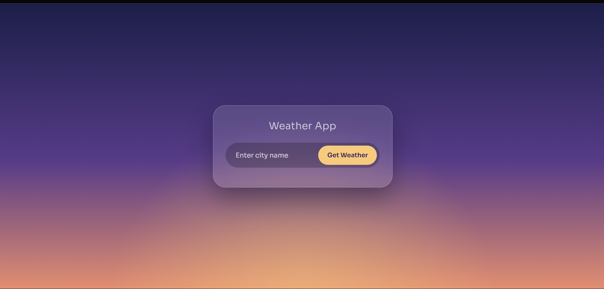
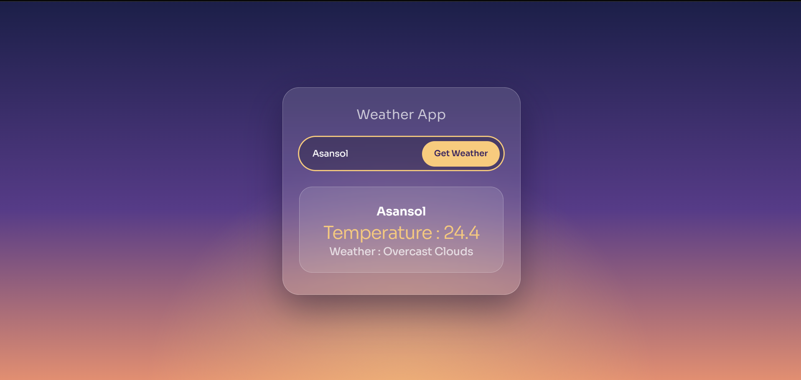
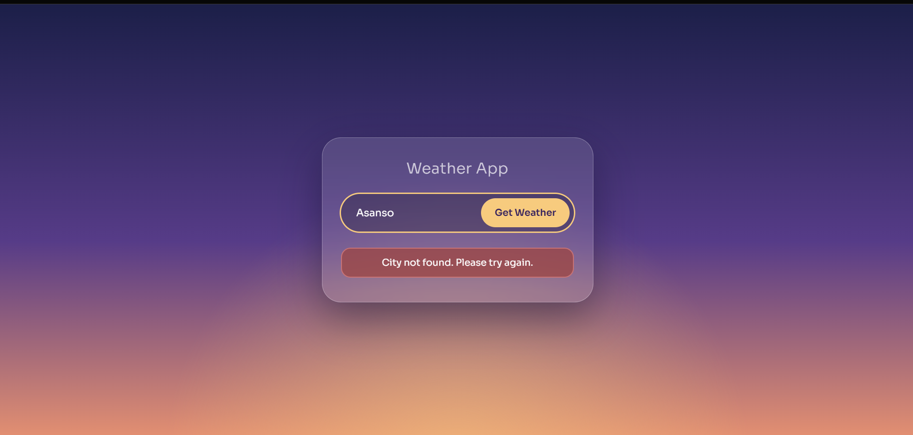

# Weather App

A web-based weather application that allows users to search for a city and view its current weather conditions using real-time data from the OpenWeatherMap API.

## Overview

This project was built using HTML, CSS, and JavaScript to practice API integration, asynchronous JavaScript, DOM manipulation, and responsive UI design.

The application retrieves weather data for a given city and displays its name, temperature in Celsius, and weather description.

## Features

- Search weather conditions by city name
- Display current temperature in Celsius
- Show weather description
- Fetch real-time data using the OpenWeatherMap API
- Handle invalid city names and API errors
- Responsive user interface


## Tech Stack

| Technology | Purpose |
|-----------|---------|
| HTML5 | Application structure |
| CSS3 | Styling, layouts, gradients, animations |
| JavaScript | Application logic and DOM manipulation |
| OpenWeatherMap API | Weather data |
| Fetch API | HTTP requests |
| Async/Await | Asynchronous operations |

## Project Structure

```text
weather-app/
├── index.html
├── script.js
├── styles.css
├── config.js
├── .gitignore
└── README.md
```

## Preview





## How It Works

1. The user enters a city name.
2. JavaScript captures and validates the input.
3. A request is sent to the OpenWeatherMap API.
4. The API returns weather data in JSON format.
5. The application updates the interface with the city name, temperature, and weather description.
6. If the request fails, an error message is displayed.

## Getting Started

### 1. Clone the repository

```bash
git clone https://github.com/soumyajitsinha/Weather-App.git
```

### 2. Navigate to the project directory

```bash
cd Weather-App
```

### 3. Configure the API key

Create a `config.js` file in the project root:

```js
const API_KEY = "YOUR_API_KEY";
```

Obtain an API key from [OpenWeatherMap](https://openweathermap.org/api).

### 4. Run the application

Open `index.html` in your browser or use the Live Server extension in VS Code.

## API Reference

This application uses the OpenWeatherMap Current Weather Data API.

**Endpoint:**

```text
https://api.openweathermap.org/data/2.5/weather
```

**Parameters:**

| Parameter | Description |
|-----------|-------------|
| `q` | City name |
| `units` | Temperature unit (`metric` for Celsius) |
| `appid` | API key |

## What I Learned

- Working with external APIs
- Using `fetch()` to retrieve data
- Handling asynchronous operations with `async/await`
- Managing errors with `try/catch`
- DOM manipulation and event listeners
- Handling user input
- Organizing frontend project files
- Creating responsive layouts and modern CSS styling

## Future Improvements

- Display weather icons
- Add humidity and wind speed
- Show feels-like temperature
- Add loading indicators
- Improve API key security using a backend
- Add recent search history


